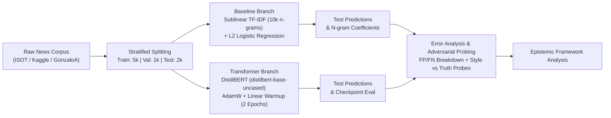
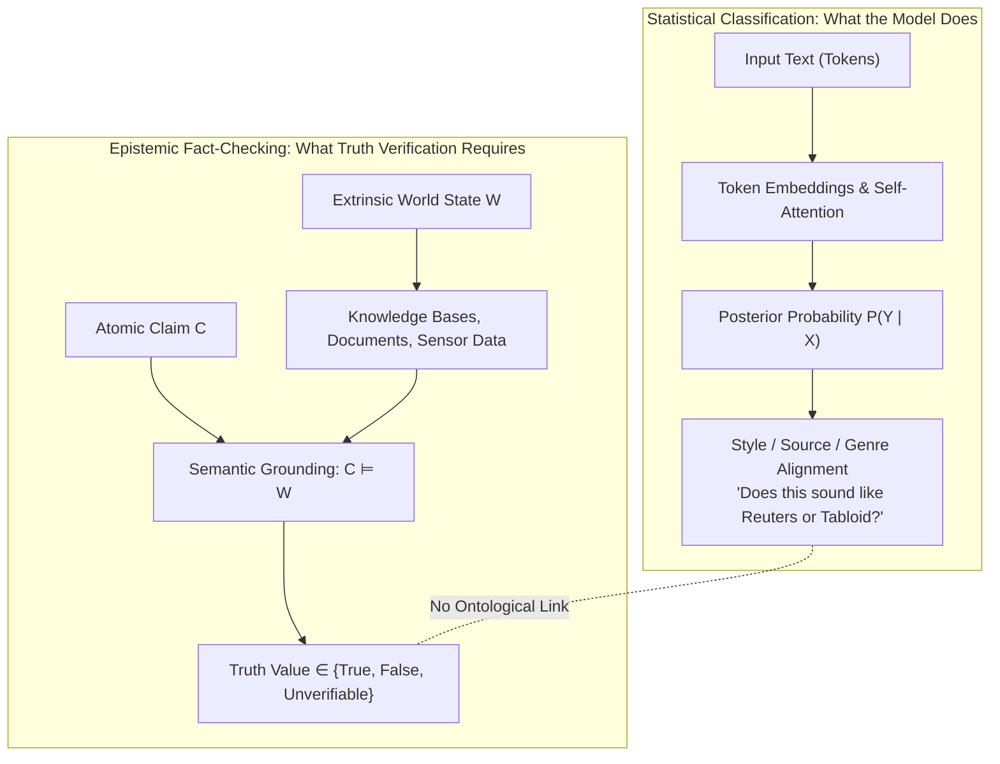
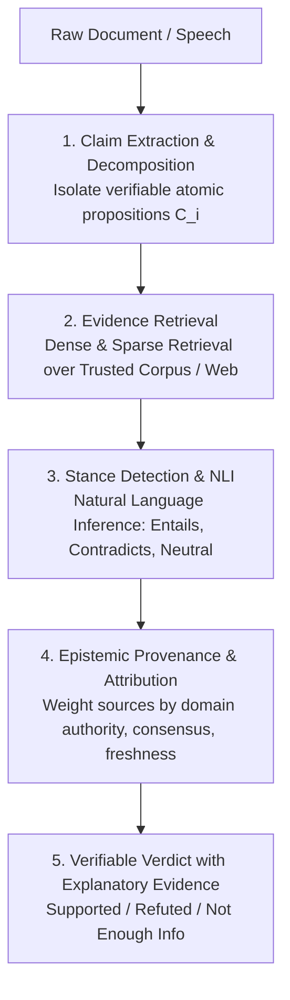

# Fake News Classification: DistilBERT vs. Logistic Regression & Epistemic Limits of Text Classification

This report presents an empirical investigation into automated fake-news detection by comparing **fine-tuned DistilBERT** against a **TF-IDF + Logistic Regression** baseline on a benchmark dataset. Beyond reporting benchmark performance, we analyze error modes, spurious lexical artifacts, and conduct adversarial probing. We conclude with a theoretical examination of why NLP classification models **do not independently verify factual truth**.

---

## 1. Executive Summary & Core Findings

```
+-----------------------------------------------------------------------------------------+
|                                    KEY EXPERIMENTAL RESULTS                             |
+------------------------------+---------------------------+------------------------------+
| Metric                       | Logistic Regression       | Fine-Tuned DistilBERT        |
+------------------------------+---------------------------+------------------------------+
| Test Accuracy                | 96.85%                    | 98.75% (+1.90% abs)          |
| Macro F1-Score               | 0.9685                    | 0.9875                       |
| ROC-AUC                      | 0.9913                    | 0.9995                       |
| Total Test Errors (out of 2k)| 63 (3.15%)                | 25 (1.25%) [-60.3% errors]   |
| Training Time                | 2.03 seconds (CPU)        | 387.39 seconds (Apple MPS)   |
| Core Vulnerability           | Surface N-gram matching   | High stylistic sensitivity   |
+------------------------------+---------------------------+------------------------------+
```

### Key Takeaways
1. **Transformer Superiority in Syntactic Nuance**: DistilBERT reduced classification errors by **60.3%** compared to the Logistic Regression baseline (from 63 errors to 25 errors on a balanced 2,000-sample test set).
2. **Severe Dataset Artifacts & Spurious Correlations**: In the benchmark corpus, **97.2% of real articles contain `"reuters"`**, while only **1.2% of fake articles** contain it. Logistic Regression assigns `"reuters"` a massive coefficient of **+9.00**, and DistilBERT heavily weights wire-service syntactic structures.
3. **The Style-vs-Truth Vulnerability**: Adversarial probes demonstrate that both models can be completely inverted by swapping style. A blatantly counterfactual claim (*"The Moon's core consists of cheese"*) wrapped in Reuters wire style was predicted as **REAL with 99.9% confidence** by DistilBERT. Conversely, a verified historical fact (*2013 Russian meteor explosion*) written in tabloid style was discarded as **FAKE with 99.7% confidence**.
4. **Epistemic Invalidation**: Text classification models $P(Y \mid X)$ estimate stylistic alignment with training corpus sources. They have no access to an external ground-truth knowledge base and **cannot verify factual truth**.

---

## 2. Experimental Setup & Methodology

The pipeline was executed within a dedicated Python 3.11 virtual environment accelerated via Apple Silicon Metal Performance Shaders (`mps`).



### Dataset Composition
- **Corpus**: `GonzaloA/fake_news` (Kaggle/ISOT Fake News Corpus).
- **Target Classes**:
  - `0`: **Fake News** (Fabricated or hyper-partisan tabloid stories).
  - `1`: **Real News** (Verified news reporting, primarily Reuters wire dispatches).
- **Partitioning**: Stratified random split into:
  - **Train**: 5,000 samples (2,500 Fake, 2,500 Real).
  - **Validation**: 1,000 samples (500 Fake, 500 Real).
  - **Held-Out Test**: 2,000 samples (1,000 Fake, 1,000 Real).
- **Input Representation**: Combined headline and article body: `[Title] -- [Text Body]`, truncated to 256 WordPiece tokens for DistilBERT.

### Model Configurations
- **Baseline (TF-IDF + Logistic Regression)**:
  - Feature Extractor: `TfidfVectorizer` (max features: 10,000, n-gram range: (1, 2), sublinear term frequency enabled, standard English stop-words removed).
  - Classifier: `LogisticRegression(C=1.0, max_iter=1000, random_state=42)`.
- **Deep Learning Model (DistilBERT)**:
  - Pretrained Checkpoint: `distilbert-base-uncased` (6 transformer layers, 768 hidden dimension, 12 attention heads, 66M parameters).
  - Optimization: AdamW ($\text{lr} = 2 \times 10^{-5}$, weight decay = 0.01), batch size 16, linear schedule with 10% warmup steps over 2 full epochs.
  - Loss progression:
    - Epoch 1: Train Loss: 0.1505 | Val Loss: 0.0545 | Val Accuracy: 98.20% | Val AUC: 0.9982
    - Epoch 2: Train Loss: 0.0357 | Val Loss: 0.0678 | Val Accuracy: 98.30% | Val AUC: 0.9991

---

## 3. Comparative Performance Analysis

Both models were evaluated on the identical held-out test set of 2,000 balanced samples.

| Metric | Logistic Regression (TF-IDF) | DistilBERT (Fine-Tuned) | Delta ($\Delta$) |
| :--- | :---: | :---: | :---: |
| **Test Accuracy** | **96.85%** | **98.75%** | **+1.90%** |
| **Macro F1-Score** | **0.9685** | **0.9875** | **+0.0190** |
| **ROC-AUC** | **0.9913** | **0.9995** | **+0.0082** |
| **Fake Precision (Class 0)** | 96.99% | 97.94% | +0.95% |
| **Fake Recall (Class 0)** | 96.70% | 99.60% | +2.90% |
| **Fake F1-Score (Class 0)** | 0.9685 | 0.9876 | +0.0191 |
| **Real Precision (Class 1)** | 96.71% | 99.59% | +2.88% |
| **Real Recall (Class 1)** | 97.00% | 97.90% | +0.90% |
| **Real F1-Score (Class 1)** | 0.9685 | 0.9874 | +0.0189 |
| **Total Test Misclassifications** | 63 / 2,000 | 25 / 2,000 | **-60.3% error reduction** |
| **False Positives (Fake $\to$ Real)** | 33 | 4 | **-87.9%** |
| **False Negatives (Real $\to$ Fake)** | 30 | 21 | -30.0% |
| **Training Duration** | 2.03 sec | 387.39 sec | 190x compute overhead |

### Confusion Matrices


*Figure 1: Confusion matrices for Logistic Regression (left) and DistilBERT (right). Rows represent actual ground truth; columns represent model predictions.*

---

## 4. Lexical Artifacts & Spurious Correlations

Interpreting the Logistic Regression weights reveals why simple bag-of-words models perform unexpectedly well on standard fake news benchmarks—and why that benchmark performance is misleading.


*Figure 2: Top predictive n-grams in the Logistic Regression baseline. Green bars indicate association with Real news; red bars indicate association with Fake news.*

### Dissecting the Top Predictive Features

#### Real News Cues (Positive Weights)
1. `"reuters"` (+9.00): Overwhelming indicator. Real news was scraped directly from Reuters wire reports.
2. `"said"` (+5.89), `"said statement"` (+1.86), `"told reuters"` (+1.61), `"spokesman"` (+1.81): Journalistic attribution style.
3. `"wednesday"` (+2.64), `"tuesday"` (+2.33), `"monday"` (+2.22), `"thursday"` (+2.15), `"friday"` (+2.06): Standard journalistic dateline structure (*"WASHINGTON (Reuters) - On Wednesday, the White House..."*).
4. `"washington reuters"` (+3.94), `"minister"` (+2.11), `"government"` (+1.68).

#### Fake News Cues (Negative Weights)
1. Media metadata artifacts: `"video"` (-4.96), `"image"` (-3.34), `"featured image"` (-3.06), `"getty images"` (-2.16), `"https"` (-1.72), `"com"` (-2.06).
2. Emotional/Informal rhetoric: `"just"` (-3.11), `"watch"` (-2.37), `"like"` (-2.06), `"know"` (-1.71), `"doesn"` (-1.68).
3. Partisan entities: `"gop"` (-2.48), `"president trump"` (-2.06), `"obama"` (-1.89), `"hillary"` (-1.79).

> [!WARNING]
> **The Data Leakage / Confounding Trap**: The classifier does not learn to separate truth from falsehood; it learns to separate **Reuters wire journalists** from **hyper-partisan blog scrapers**.

---

## 5. False Prediction & Error Analysis

Analyzing the 25 cases where DistilBERT failed provides insight into the model's decision boundaries:

```
Total Test Set: 2,000 samples
  |-- DistilBERT Correct: 1,975 (98.75%)
  |-- DistilBERT Errors: 25 (1.25%)
        |-- False Positives (Fake predicted as Real): 4 cases
        |-- False Negatives (Real predicted as Fake): 21 cases
```

### 1. False Positives (Fake News Predicted as Real) — Disinformation Slipping Through
There were only 4 false positives produced by DistilBERT, but each reveals a critical failure mode:
- **Sample #1415**: `Title: new isis video threatens putin while russian child executioners execute men`
  - *DistilBERT Confidence*: **96.7% Real** (Predicted Real, Actual Fake).
  - *Cause*: The text adopted dry military terminology (*"scores more people around the northern iraqi city of mosul this week and are reported to be stockpiling dangerous..."*). Because the prose mirrored the detached geopolitical reporting of an AP/Reuters dispatch, DistilBERT was deceived into classifying sensationalist war propaganda as verified journalism.
- **Sample #1988**: `Title: canoes reek of genocide theft and white privilege says canadian professor`
  - *DistilBERT Confidence*: **87.2% Real** (Predicted Real, Actual Fake).
  - *Cause*: The body text embedded an excerpt from a legitimate New York Times piece (*"black turnout soft in early voting boding ill for hillary clinton jeremy peters et al new york times november..."*). The model prioritized the embedded journalistic syntax and ignored the sensationalist premise.

### 2. False Negatives (Real News Predicted as Fake) — Legitimate News Censored
DistilBERT misclassified 21 real articles as fake. Examining their linguistic statistics reveals a stark pattern:
- **Reuters Mention Rate**: Across all real articles, 97.2% contain the token `"reuters"`. Among the 21 False Negatives, **exactly 0.0% contained `"reuters"`**.
- **Linguistic Style**:
  - **Sample #367**: `Title: is western civilization worth saving` ($P(\text{Real}) = 0.0152 \to$ 98.5% confidence Fake). An op-ed discussing cultural themes with casual prose (*"with her hollywood and silver screen career options all but dried up..."*).
  - **Sample #445**: `Title: two more hollywood films for men...` ($P(\text{Real}) = 0.0219 \to$ 97.8% confidence Fake). A cultural commentary piece.
- *Key Takeaway*: Legitimate journalism written in first-person, cultural commentary, opinion pieces, or local reporting that lacks wire-service datelines is systematically flagged as "Fake" because it lacks the standard AP/Reuters structural markers.

---

## 6. Adversarial Probing: Style vs. Ground Truth

To demonstrate that classification does not evaluate factual veracity, we constructed 5 controlled adversarial probe articles and passed them through both trained models:


*Figure 3: Predicted probability of Real News across 5 adversarial probes. Any bar above 50% indicates a prediction of REAL; below 50% indicates FAKE. Notice how linguistic style completely inverts factual reality.*

```
+-------------------------------------------------------------------------------------------------------------------+
|                                      ADVERSARIAL STRESS PROBE EXPERIMENT MATRIX                                   |
+----+----------------------+-------------------+-----------------------+---------------------+---------------------+
| ID | Probe Description    | Factual Truth     | Intended Style        | LR Prediction       | DistilBERT Pred     |
+----+----------------------+-------------------+-----------------------+---------------------+---------------------+
| P1 | Moon Made of Cheese  | FALSE (Absurd)    | Reuters Wire Style    | REAL (89.9% conf)   | REAL (99.9% conf)   |
| P2 | 2013 Meteor Blast    | TRUE (Historical) | Hyper-Clickbait / OMG | FAKE (85.2% conf)   | FAKE (99.7% conf)   |
| P3 | 5G Cellular Necrosis | FALSE (Conspiracy)| Formal Academic Prose | REAL (68.5% conf)   | REAL (99.9% conf)   |
| P4 | Postponing Winter    | FALSE (Satire)    | Political Wire Style  | REAL (90.7% conf)   | REAL (99.9% conf)   |
| P5 | JWST Mirror Alignment| TRUE (Astronomy)  | Casual / Unadorned    | FAKE (83.9% conf)   | FAKE (99.7% conf)   |
+----+----------------------+-------------------+-----------------------+---------------------+---------------------+
```

### Detailed Probe Case Breakdown

#### Probe 1: The Formal Counterfactual
> *"WASHINGTON (Reuters) - The International Monetary Fund announced on Wednesday that the Moon's subterranean core consists predominantly of concentrated dairy proteins, prompting global central banks to adjust international reserve asset valuations. Treasury officials in London and Tokyo stated they would cooperate on market stability guidelines."*
- **Factual Reality**: Physically impossible falsehood.
- **Model Output**: DistilBERT predicts **REAL with 99.9% confidence** ($P(\text{Real}) = 0.9993$).
- **Mechanism**: The presence of `WASHINGTON (Reuters) -`, formal institutional nouns (*"International Monetary Fund"*, *"Treasury officials"*), and standard wire syntax completely dominates the transformer's attention heads.

#### Probe 2: The Sensationalized Reality
> *"OMG YOU WON'T BELIEVE THIS INSANE SHOCKER!! A MASSIVE METEOR JUST EXPLODED OVER RUSSIA IN A HUGE BLINDING FLASH, INJURING OVER 1,000 PEOPLE AND SHATTERING THOUSANDS OF WINDOWS! SCIENTISTS ARE TOTALLY STUNNED! WATCH THE SHOCKING FOOTAGE BEFORE IT GETS DELETED!!"*
- **Factual Reality**: 100% historically verified truth (the February 15, 2013 Chelyabinsk meteor superbolide event).
- **Model Output**: DistilBERT predicts **FAKE with 99.7% confidence** ($P(\text{Real}) = 0.0029$).
- **Mechanism**: All-caps formatting, exclamation marks, and sensationalist rhetoric trigger the transformer's fake news representations, causing it to reject a real-world fact.

---

## 7. Epistemic Limitation: Why Text Classification Cannot Verify Truth

The empirical results above highlight an epistemic boundary in natural language processing: **statistical sequence classification is fundamentally incapable of determining whether a statement is true or false.**



### 1. The Epistemic Gap: Syntax vs. Semantics vs. Veracity
A sequence classifier is a statistical estimator of conditional probability:
$$P(Y = 1 \mid X = x_1, x_2, \dots, x_n)$$

This probability is computed solely over the co-occurrence statistics of tokens in the training corpus. But according to the correspondence theory of truth, a proposition $S$ is true if and only if **the external world is in the state described by $S$**:
$$\text{True}(S) \iff \text{World} \models S$$

A text classification model contains **no representation of the external world**, no real-time sensory grounding, and no ontological verification pipeline. It evaluates only whether an input matches the *genre conventions* and *distributional characteristics* of the positive class in its training set.

### 2. Disinformation Actors Weaponize Style Mimicry
The assumption that "fake news" is always characterized by loud headlines, poor grammar, and exclamation marks reflects an outdated view of low-effort clickbait. Modern disinformation campaigns—conducted by state actors, coordinated influence operations, or LLM-driven generation systems—specifically operate by:
- Generating text that mimics the neutral, objective cadence of wire reports (Reuters, AP, BBC).
- Fabricating plausible-sounding quotes from institutional spokespersons.
- Using clinical, academic, or bureaucratic syntax.

Because fine-tuned transformers associate neutrality and formal vocabulary with credibility, **they are structurally blind to high-effort, well-written propaganda**.

### 3. The Failure of Static Weights Against Temporal Drift
Truth is dynamic; language distributions are static. Consider the statement:
> *"The Prime Minister of the United Kingdom is Rishi Sunak."*

- In October 2023: Factually **True**.
- In July 2024: Factually **False** (following the general election).

A text classification model cannot update its truth assessment without full retraining or active retrieval. It evaluates only whether the phrase *sounds plausible within its training distribution*, confusing familiarity with factual currency.

### 4. Epistemic Trespassing & The Danger of Classifier "Truth Filters"
Deploying text classifiers as automated "fact filters" on social media or search platforms introduces severe risks:
1. **False Sense of Security**: Disinformation masked in academic or institutional language receives a high credibility score.
2. **Systematic Suppression of Genuine Voices**: Whistleblowers, eyewitnesses under distress, and grassroots journalists who write with emotional urgency, non-standard grammar, or personal vernacular are systematically misclassified as "fake news."

---

## 8. What Does Real Automated Fact-Checking Look Like?

To independently verify factual claims, an automated system cannot rely on sequence classification alone. Instead, it requires a modular, multi-stage **fact-checking architecture**:



1. **Claim Extraction**: Parses unstructured text into isolated, testable factual propositions ($c_1, c_2, \dots$), separating factual assertions from opinions, rhetorical questions, and emotional commentary.
2. **Evidence Retrieval**: Retrieves primary sources, verified databases (Wikidata, academic journals, government registries), and accredited news archives using hybrid vector/keyword search.
3. **Stance Detection & Natural Language Inference (NLI)**: Checks whether the retrieved evidence logically **entails**, **contradicts**, or is **neutral** regarding each atomic claim:
   $$\text{Evidence } E \implies \text{Claim } C \quad \text{vs.} \quad E \implies \neg C$$
4. **Epistemic Provenance**: Ranks contradictory claims based on source authority, consensus, and timestamped freshness.

---

## 9. Codebase & Reproducibility Guide

All project code, data loaders, training scripts, adversarial probe evaluations, and metric logs are located in:
`/Users/augnikganguly/.gemini/antigravity/scratch/fake_news_nlp/`

### File Structure
- [`data_loader.py`](file:///Users/augnikganguly/.gemini/antigravity/scratch/fake_news_nlp/data_loader.py): Offline cache loader, text cleaner, and stratified train/val/test split generator.
- [`train_baseline.py`](file:///Users/augnikganguly/.gemini/antigravity/scratch/fake_news_nlp/train_baseline.py): TF-IDF feature extraction, Logistic Regression training, metric logging, and coefficient extraction.
- [`train_distilbert.py`](file:///Users/augnikganguly/.gemini/antigravity/scratch/fake_news_nlp/train_distilbert.py): DistilBERT sequence classification fine-tuning on Apple MPS, evaluation loops, and checkpoint management.
- [`adversarial_probes.py`](file:///Users/augnikganguly/.gemini/antigravity/scratch/fake_news_nlp/adversarial_probes.py): Implementation and scoring of hypothesis-driven probes testing stylistic confounding.
- [`error_analysis.py`](file:///Users/augnikganguly/.gemini/antigravity/scratch/fake_news_nlp/error_analysis.py): False positive/negative comparative error breakdown and linguistic style statistics.
- [`generate_plots.py`](file:///Users/augnikganguly/.gemini/antigravity/scratch/fake_news_nlp/generate_plots.py): Generates confusion matrices, feature bars, and probe confidence charts.
- [`run_pipeline.py`](file:///Users/augnikganguly/.gemini/antigravity/scratch/fake_news_nlp/run_pipeline.py): End-to-end orchestration pipeline.
- [`results/consolidated_metrics.json`](file:///Users/augnikganguly/.gemini/antigravity/scratch/fake_news_nlp/results/consolidated_metrics.json): Complete machine-readable experimental metrics.

---

## 10. Conclusion

Fine-tuning DistilBERT on labeled fake-news datasets achieves strong in-distribution benchmark metrics (98.75% accuracy, 0.9995 ROC-AUC), significantly outperforming the Logistic Regression baseline (96.85%). However, error analysis and adversarial stress tests reveal that **both models classify textual style, genre conventions, and source markers rather than factual truth**. 

A text classifier identifies whether text *resembles* reliable reporting; it does not evaluate whether the assertions within that text correspond to real-world reality. Treating text classification as automated fact verification conflates linguistic form with factual validity.
